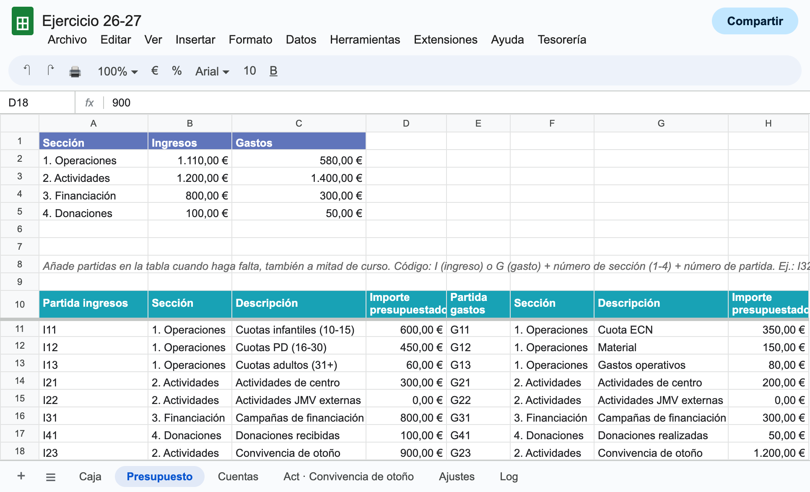
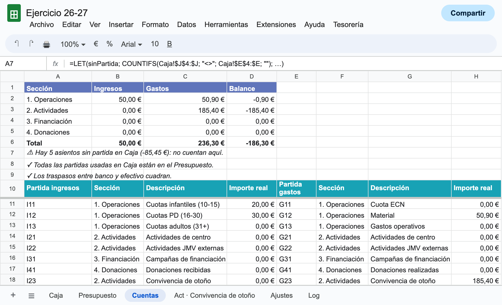
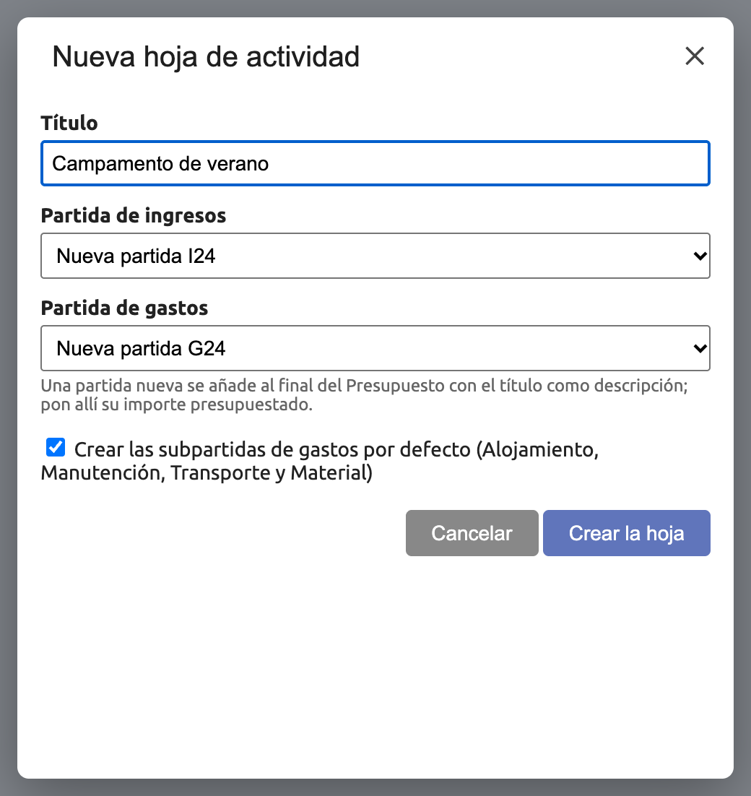
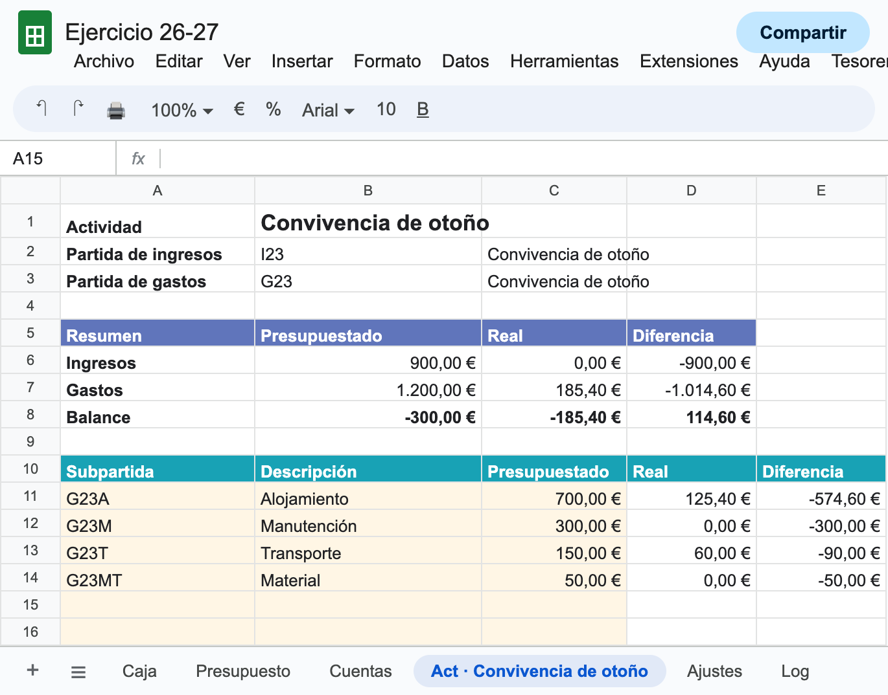

# Actividades y presupuesto

Al empezar el curso, el equipo decide cuánto espera ingresar y gastar: es el
**presupuesto**. Durante el curso, el libro compara lo presupuestado con lo
**real** en tres sitios: la hoja **Presupuesto**, la hoja **Cuentas** y una
hoja para cada actividad.

## La hoja Presupuesto

- Arriba, un **resumen por secciones** (Operaciones, Actividades,
  Financiación, Donaciones) que se calcula solo.
- Desde la fila 11, la **tabla de partidas**: ingresos a la izquierda (columnas
  A a D) y gastos a la derecha (E a H). Cada partida tiene su código, su
  descripción y el **importe presupuestado**.

### Poner los importes del presupuesto

Escribe en la columna **Importe presupuestado** de cada partida la cantidad
que aprobó el equipo o la asamblea. La columna **Sección** se rellena sola a
partir del código.

### Añadir una partida

Se pueden añadir partidas **en cualquier momento**, también a mitad de curso
(por ejemplo, para una campaña nueva):

1. Ve a la primera fila vacía de su lado de la tabla (ingresos o gastos).
2. Escribe el **código**: `I` o `G`, el número de la sección y un número que no
   esté usado. Por ejemplo, para una nueva campaña de financiación: `I32` y
   `G32`.
3. Escribe la **descripción** y el importe.

La partida aparece sola en los desplegables de Caja, en las ventanas y en
Cuentas.

!!! info "Para una actividad, mejor la hoja de actividad"

    Si la partida nueva es para una actividad (una convivencia, un
    campamento), no la crees a mano: la ventana de **Nueva hoja de
    actividad** crea las partidas y la hoja a la vez (ver abajo).

## La hoja Cuentas

Es igual que Presupuesto, pero con lo que **de verdad** se ha ingresado y
gastado en cada partida. **No se escribe nada en ella**: se rellena sola.

Fíjate en las filas 7 a 9: son **comprobaciones**. Si alguna empieza por ⚠,
algo no cuenta en las cuentas. En el ejemplo, hay cinco asientos sin partida:
se arregla [completando los movimientos](completar-movimientos.md).

## Hojas de actividad

Cada actividad con dinero propio (una convivencia, un campamento, la lotería)
puede tener su hoja, con su presupuesto, lo real y la lista de sus
movimientos.

### Crear una hoja de actividad

1. Menú **Tesorería → Actividades → Nueva hoja de actividad…** (o **Nueva hoja
   de financiación…**, para lotería, rastrillos y demás actividades para sacar
   fondos).
2. Escribe el **título** de la actividad.

    

3. Deja **Nueva partida** en ingresos y en gastos: el libro crea las dos
   partidas en el Presupuesto, con el título como descripción. Si la actividad
   ya tiene partidas, elígelas de la lista.
4. Deja marcada la casilla de **subpartidas por defecto**: crea alojamiento,
   manutención, transporte y material (o ventas, material y promoción, en una
   de financiación).
5. Pulsa **Crear la hoja**. Después, pon en el Presupuesto los importes de las
   partidas nuevas.

### Lo que hay en la hoja

- **Resumen**: ingresos, gastos y balance, presupuestados y reales.
- **Subpartidas**: en las celdas de color crema puedes cambiar los nombres,
  añadir subpartidas nuevas (siempre empezando por el código de la partida,
  `G23` + letras: `G23S` para seguros) y poner el presupuesto de cada una. Lo
  real se calcula solo.
- Más abajo, desde la fila 26, la **lista de movimientos** de la actividad,
  que se actualiza sola.

!!! info "Lo pendiente ya cuenta aquí"

    En el ejemplo, los gastos reales de la convivencia (185,40 €) incluyen la
    señal del albergue, que es una transferencia todavía
    [pendiente](pagar-transferencia.md#6-mientras-tanto-pendiente). Así ves lo
    comprometido, aunque el dinero no haya salido aún.

??? info "Columnas propias en la hoja de actividad"

    A partir de la columna **N** puedes añadir tus propios cálculos (por
    ejemplo, el coste por participante). Mejor con fórmulas que se refieran a
    su misma fila: la lista de movimientos se recoloca cada vez que entra uno
    nuevo, y un dato escrito a mano se quedaría al lado de otro movimiento.

 
