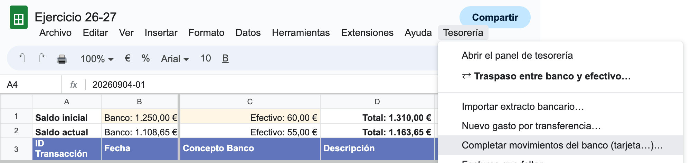
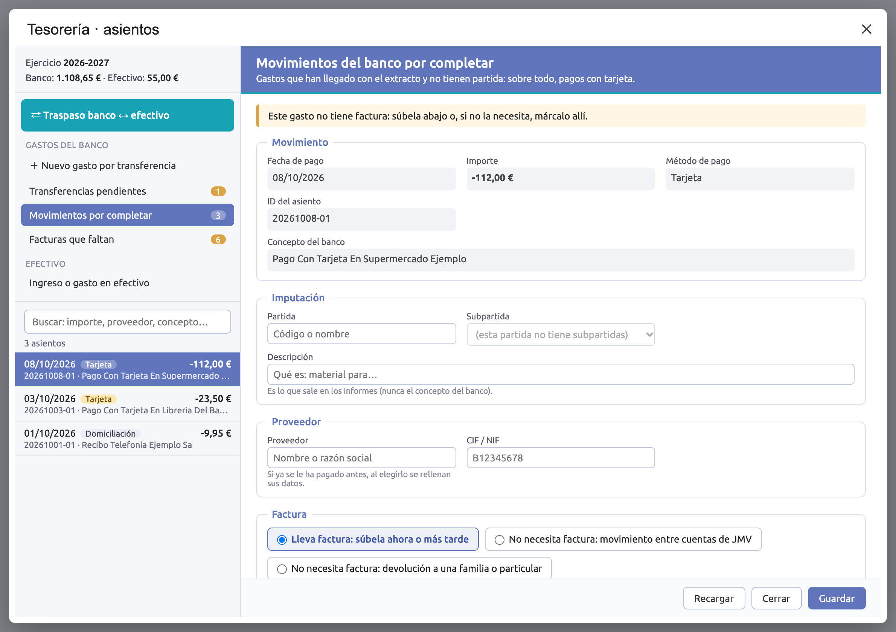
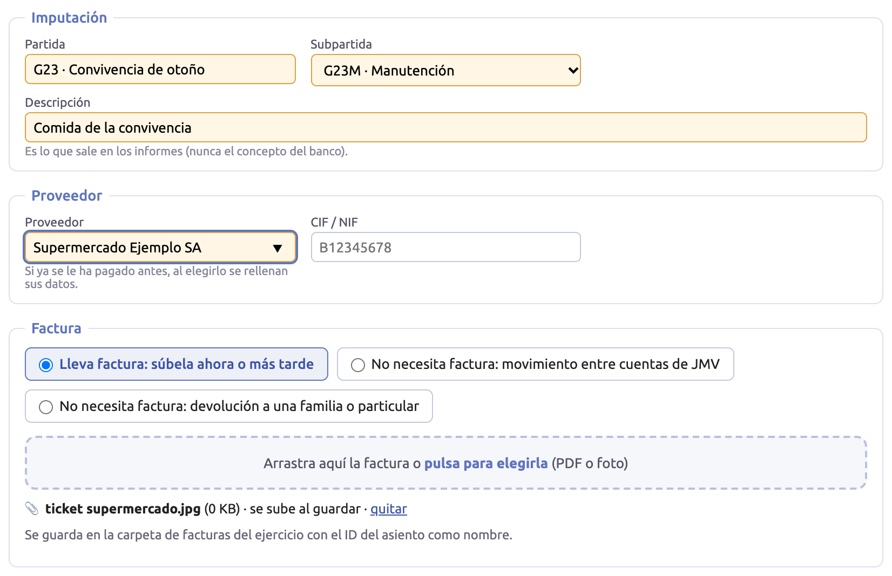
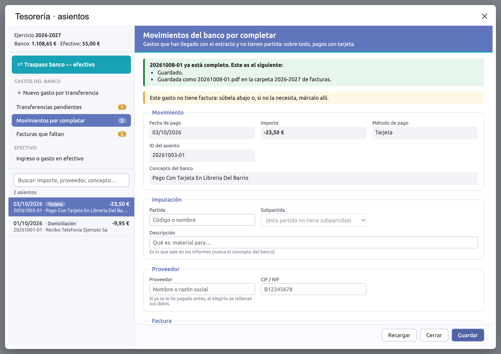

# Completar los pagos con tarjeta

Los pagos con **tarjeta**, los **recibos** domiciliados (el teléfono, un
seguro…) y las **comisiones** del banco no se apuntan antes: el libro se entera
de ellos cuando importas el extracto. Llegan con su fecha, su importe y el
texto del banco («Pago Con Tarjeta En Supermercado Ejemplo»), pero sin decir
para qué eran. Esta guía es para completarlos.

Hazlo **justo después de [importar el extracto](importar-extracto.md)**,
mientras te acuerdas de cada compra y tienes los tickets a mano.

### 1. Abre la lista

Menú **Tesorería → Completar movimientos del banco (tarjeta…)…**

A la izquierda sale la lista de **gastos del banco que no tienen partida**,
del más reciente al más antiguo. Los de tarjeta llevan la etiqueta
**Tarjeta** en amarillo. El número junto a *Movimientos por completar* dice
cuántos quedan.

Arriba a la derecha tienes lo que dice el banco del movimiento: la fecha, el
importe, el método de pago y el **concepto del banco**, que suele decir dónde
se pagó. Eso no se puede cambiar: es lo que pasó en el banco.

!!! info "Para encontrar uno concreto"

    Escribe en el buscador de la lista el importe (`112`), el comercio
    (`supermercado`) o la fecha (`08/10`).

### 2. Rellena lo que falta

1. **Partida**: escribe parte del nombre o el código y elige de la lista. Por
   ejemplo, la compra de comida para la convivencia: «conviv» → **G23 ·
   Convivencia de otoño**.
2. **Subpartida**, si la partida tiene: aquí, **G23M · Manutención**.
3. **Descripción**: qué se compró, en pocas palabras («Comida de la
   convivencia»). Es lo que sale en los informes; el texto del banco no sale
   nunca, porque puede llevar datos personales.
4. **Proveedor** y su **CIF**, si vienen en el ticket o la factura.
5. **Factura**: arrastra la foto del ticket o el PDF de la factura al
   recuadro. Si es un movimiento entre cuentas de JMV o una devolución,
   marca **No necesita factura** con su motivo
   ([Gastos que no llevan factura](facturas.md#gastos-que-no-llevan-factura)).

Los campos que cambias se ponen en naranja hasta que guardas.

### 3. Guarda y pasa al siguiente

Pulsa **Guardar**. El movimiento desaparece de la lista y la ventana abre **el
siguiente**, para que sigas sin tener que buscarlo:

Cuando la lista se queda vacía, todos los gastos del banco tienen partida. ✓

!!! success "Si no tienes el ticket"

    Guarda igualmente la partida y la descripción. El movimiento saldrá de
    esta lista, pero seguirá en [Facturas que faltan](facturas.md) hasta que
    subas el justificante.

??? info "¿Y las comisiones del banco?"

    Las comisiones y los intereses (*Cargo bancario*) también salen en esta
    lista, porque necesitan partida (normalmente la de gastos operativos,
    `G13`). Lo que no necesitan es factura: el propio extracto lo justifica.

??? info "¿Y los ingresos sin partida?"

    Esta lista es solo de gastos. Los ingresos que llegan sin partida suelen
    ser cuotas, que se explican en [Cuotas de socio](cuotas.md). Para otro tipo
    de ingreso (una donación, el pago de una actividad), pon la partida
    directamente en la hoja: ver [Apuntar a mano en la hoja](escribir-en-la-hoja.md).

 
