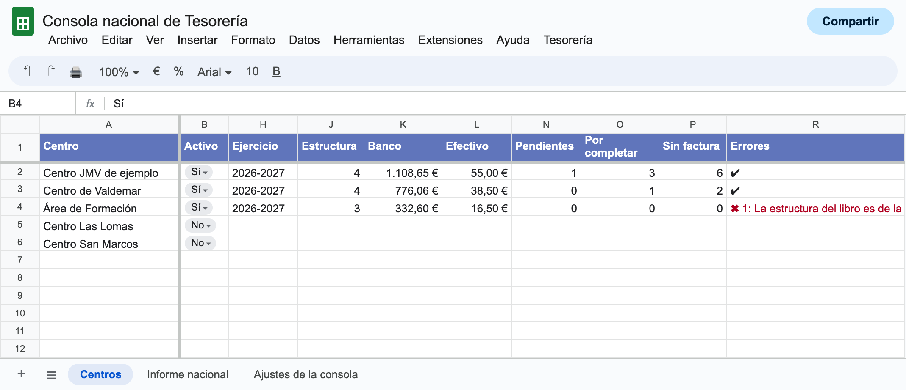
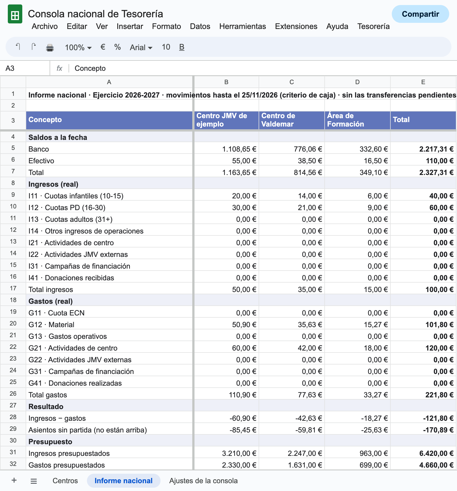
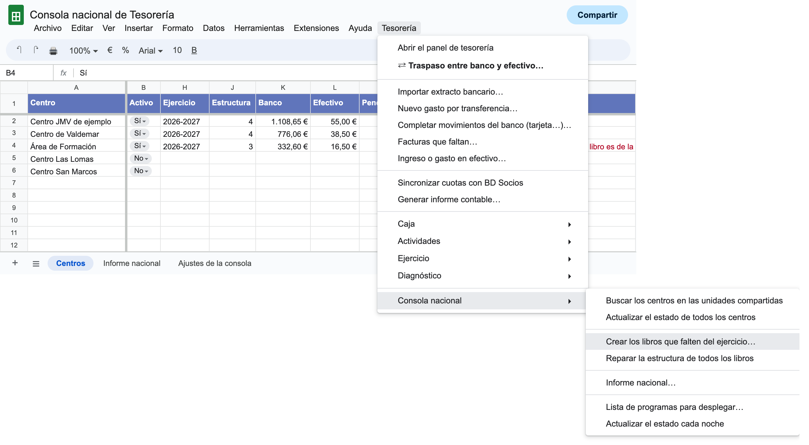

# Consola nacional

La consola nacional es una hoja de cálculo que reúne a **todos los centros y
áreas** que usan el libro de cuentas. Desde ella se ve cómo va cada uno, se
crean los libros de cada curso y se suman las cuentas de todos en el
**informe nacional**.

Esta página es para el **equipo nacional de tesorería** y para la
**administración**. Si llevas la tesorería de un centro, no la necesitas: lo
que te toca a ti está en [Cambio de ejercicio](cambio-de-ejercicio.md).

!!! info "Preparar la consola y publicar el programa"

    Cómo se crea la consola (una vez), el libro plantilla y cómo se sube cada
    versión nueva del programa a todos los libros está en la
    [guía de despliegue](https://github.com/JMV-Espana/BD_Tesoreria/blob/main/DESPLIEGUE.md),
    pensada para la administración. Aquí se explica el **uso** de la consola.

## Antes de empezar

- La consola está en la unidad compartida de la administración. Para usarla
  tienes que poder **editarla**.
- **Trabaja con tu cuenta.** Solo encuentra las unidades compartidas que tú
  ves, y solo puede abrir los libros de los centros a los que tienes acceso.
  Lo normal es usarla con la cuenta de administración, que entra en todas.
- Lleva el mismo programa que los libros de los centros, así que la primera
  vez hay que **autorizarlo**, como se explica en
  [Primeros pasos](primeros-pasos.md#5-la-primera-vez-autorizar-el-programa).
- Todo se hace desde el menú **Tesorería → Consola nacional**, que solo
  aparece en la consola. El resto del menú **Tesorería** es el de un libro de
  cuentas y aquí no se usa.

## Las hojas de la consola

### Centros

Una fila por centro o área. Cada fila dice dónde están sus cosas y cómo
van sus cuentas.

Solo escribes **tres columnas**. Las demás las rellena la consola:

| Columna | Qué es |
|---|---|
| **Centro** | El nombre del centro o área. Al encontrarlo, la consola pone el de su unidad compartida; puedes cambiarlo. |
| **Activo** | **Sí** si el centro ya usa el libro de cuentas (está en el piloto). La consola **solo trabaja con los activos**: los demás no se tocan. Los que encuentra nuevos entran con **No**. |
| **Código** | El código del centro en JMV España, si lo tiene. Es opcional: sale junto al nombre en la cabecera de sus informes en PDF. Se copia a la hoja Ajustes de su libro al crearlo o repararlo. |
| Unidad compartida, Carpeta Tesorería | Dónde está el centro en Drive. |
| BD Socios | Su base de datos de socios, si la tiene (casi ningún centro). |
| Libro, Ejercicio | Su libro de cuentas del curso con el que trabaja la consola. |
| Programa | El programa de su libro, para publicar versiones nuevas. Aparece cuando alguien abre el libro por primera vez. |
| Estructura | La versión de la estructura de su libro. Si es menor que la del programa, hay que repararlo (ver más abajo). |
| Banco, Efectivo | Saldos de hoy. |
| Último extracto | Hasta qué día ha importado el extracto del banco. |
| Pendientes | Transferencias apuntadas que el banco aún no ha confirmado. |
| Por completar, Sin factura, Sin partida | Lo que le falta al centro por apuntar. Es lo mismo que ve en su panel. |
| Errores, Avisos | El resultado del Diagnóstico de su libro: ✔ si está todo bien; ✖ y el primer error si no. |
| Actualizado | Cuándo se leyó todo esto por última vez. |

!!! warning "No muevas ni borres columnas"

    La consola busca cada columna por su nombre en la fila 1. Puedes ordenar
    las filas o filtrarlas, pero no cambies los títulos.

### Informe nacional

Las cuentas de todos los centros activos a una fecha, una columna por centro
y el total a la derecha. Se rellena con **Informe nacional…** (ver más
abajo).

- **Saldos a la fecha**: banco y efectivo de cada centro el día del corte.
- **Ingresos** y **gastos** por **partida común**, las que tienen todos los
  centros (en negrita en su Presupuesto). Lo que un centro apunte en una
  partida propia suma en la común de su sección: una `G23` propia de un
  centro cuenta en `G21 · Actividades de centro`.
- **Resultado**: ingresos menos gastos. Debajo, lo que los centros tienen
  **sin partida**, que no está en ninguna fila de arriba. Si no es cero,
  pídeles que [completen los movimientos](completar-movimientos.md).
- **Presupuesto**: lo que cada centro presupuestó de ingresos y de gastos.

Cuenta con **criterio de caja**, como los informes de los centros: entra lo
que se ha cobrado o pagado hasta la fecha de corte. No cuentan las
transferencias pendientes, los traspasos entre banco y efectivo ni lo marcado
como *Ejercicio anterior*.

!!! info "El informe se sobrescribe"

    Cada vez que lo generas, la hoja se vacía y se vuelve a escribir. Si
    quieres conservar uno (el de cierre, por ejemplo), duplica la pestaña
    (clic derecho en **Informe nacional → Duplicar**) y cámbiale el nombre, o
    descárgalo (**Archivo → Descargar → PDF**).

### Ajustes de la consola

Dos ajustes:

- **Año en que empieza el ejercicio**: el curso con el que trabaja la
  consola. 2026 es el «Ejercicio 26-27». Se cambia cada septiembre (ver
  [Cerrar un ejercicio y abrir el siguiente](#cerrar-un-ejercicio-y-abrir-el-siguiente)).
- **Libro plantilla**: el enlace del libro vacío que se copia para los
  centros que empiezan. Lo prepara la administración una vez.

## Las opciones del menú

### Buscar los centros en las unidades compartidas

Recorre las unidades compartidas que ve tu cuenta. Cada unidad con una
carpeta **Tesorería** en la raíz es un centro o un área. Si aún no estaba en
**Centros**, la añade con **Activo = No**. Si encuentra su libro del curso
(«Ejercicio 26-27»), lo apunta en **Libro**.

No borra filas ni cambia lo que hayas escrito tú. Úsala cuando se cree la
unidad de un centro nuevo.

### Actualizar el estado de todos los centros

Abre el libro de cada centro activo y apunta en su fila los saldos, lo que
le falta y el resultado de su Diagnóstico. Así sabes a qué centro hay que
echar una mano sin abrir los libros uno a uno.

### Crear los libros que falten del ejercicio…

Para cada centro activo que no tiene libro del curso de la consola, se lo
crea en su carpeta Tesorería:

- si tiene el del **curso anterior**, como su **continuación**: mismas
  partidas y configuración, con los saldos finales como iniciales, sin
  asientos ni actividades;
- si no, **copiando el libro plantilla**, con su configuración vacía para
  que se rellene con la del centro.

Antes de empezar dice qué centros son y pide confirmación. Si el centro ya
había creado su libro con el nombre correcto, la consola lo adopta tal cual.

Si en su carpeta hay otra hoja con el mismo nombre que **no es un libro de
cuentas** (hecha a mano, sin el programa), no la toca y lo dice en
**Errores**. Cámbiale el nombre a esa hoja (por ejemplo, añadiendo
«(antiguo)»), vacía **Libro** y **Ejercicio** de su fila y vuelve a crear los
libros.

### Reparar la estructura de todos los libros

Pone al día la estructura de los libros (fórmulas, formatos, desplegables,
partidas comunes) **sin tocar ningún dato**. Hace falta cuando una versión
nueva del programa cambia la estructura. Lo notarás porque la columna
**Estructura** de algún centro tiene un número menor que el de los demás y
en **Errores** aparece «La estructura del libro es de la versión…», como en
la fila 4 de la primera captura.

!!! warning "Mejor a una hora sin uso"

    Mientras se repara un libro, Sheets lo recarga. Si alguien lo tiene
    abierto con una ventana de Tesorería, perderá lo que estuviera
    escribiendo en ella.

### Informe nacional…

Pide una **fecha de corte**; vacía, la de hoy (o el 31 de agosto, si el
curso ya ha terminado). Suma los libros de todos los centros activos hasta
esa fecha en la hoja **Informe nacional**.

La fecha decide el curso. Si pides el 31/08/2027 cuando la consola ya está
en el 27-28, saca el **informe de cierre del 26-27**: de cada centro toma el
libro anterior al que apunta la consola.

### Lista de programas para desplegar…

Da la lista de los programas de la consola, del libro plantilla y de los
libros activos del curso, para publicar una versión nueva del programa.
Es cosa de la administración: se explica en la
[guía de despliegue](https://github.com/JMV-Espana/BD_Tesoreria/blob/main/DESPLIEGUE.md).
Antes, **Actualizar el estado**, que es cuando se recogen los programas.

### Actualizar el estado cada noche

Hace lo mismo que **Actualizar el estado** todas las noches, de 3 a 4, sin
que nadie tenga que abrir la consola. Se instala una vez, con la cuenta que
la vaya a usar.

!!! info "«No ha dado tiempo»"

    Google corta cualquier tarea que pase de 6 minutos. Con muchos centros, la
    consola para antes y lo dice: «Quedan 4: no ha dado tiempo». Vuelve a
    pulsar la **misma opción** y seguirá por donde iba, sin repetir lo hecho.
    Lo que falle en un centro se apunta en su columna **Errores** y la
    consola sigue con el siguiente.

## Añadir un centro al piloto

1. Si no está en **Centros**: **Buscar los centros en las unidades
   compartidas**. Necesita una carpeta **Tesorería** en la raíz de su unidad.
2. En su fila, **Activo = Sí** y su **Código**, si lo tiene.
3. **Crear los libros que falten del ejercicio…**
4. Avisa al centro: su libro está en su carpeta Tesorería. Que lo abra, lo
   [autorice](primeros-pasos.md#5-la-primera-vez-autorizar-el-programa) y
   siga los [Primeros pasos](primeros-pasos.md).
5. Cuando lo hayan abierto, **Actualizar el estado**: su columna
   **Programa** ya tiene valor. Díselo a la administración para que su libro
   reciba las versiones nuevas del programa.

Para sacar un centro del piloto, **Activo = No**. Su libro sigue en su
carpeta, pero la consola deja de tocarlo y de sumarlo.

## Cerrar un ejercicio y abrir el siguiente

El ejercicio va del 1 de septiembre al 31 de agosto. Cada curso tiene su
libro, y el del curso que termina **no se borra**: se queda en la carpeta
Tesorería de cada centro como sus cuentas cerradas. Con la consola, el
cambio de curso se hace **para todos los centros a la vez**, y los centros
no crean su libro.

El orden recomendado, con el paso del 26-27 al 27-28 como ejemplo:

### 1. En julio y agosto: que cada centro llegue limpio

1. **Actualizar el estado.**
2. Repasa **Pendientes**, **Por completar**, **Sin factura**, **Sin
   partida** y **Errores**. Escribe a los centros que tengan cosas
   atrasadas: es mucho más fácil resolverlas antes del cierre.

### 2. A primeros de septiembre: crear los libros del curso nuevo

1. En **Ajustes de la consola**, cambia **Año en que empieza el ejercicio**
   a **2027**.
2. **Tesorería → Consola nacional → Crear los libros que falten del
   ejercicio…** Cada centro activo tiene ahora su «Ejercicio 27-28», como
   continuación del suyo del 26-27 (o desde la plantilla, si acaba de
   entrar).
3. Avisa a los centros: tienen el libro nuevo en su carpeta Tesorería y
   **no tienen que crearlo ellos**.

Los saldos iniciales del libro nuevo son los que tenía el viejo **al
crearlo**. Si después el centro sigue apuntando cosas de agosto en el
viejo, tiene que actualizarlos en el nuevo, como se explica en
[Cambio de ejercicio](cambio-de-ejercicio.md#si-despues-hay-que-tocar-el-ejercicio-viejo).
No hace falta esperar a que todos cierren para crear los libros.

### 3. Los centros cierran el curso viejo y empiezan el nuevo

Cada centro sigue [Cambio de ejercicio](cambio-de-ejercicio.md):

1. En el libro **viejo**: importa el extracto hasta el 31 de agosto,
   completa lo que falte, cuenta el efectivo y saca su informe de cierre.
2. En el libro **nuevo**: trae los saldos iniciales del anterior,
   **autoriza** el programa (es otro archivo), pasa el Diagnóstico y rellena
   el Presupuesto.

Mientras tanto:

- **Actualizar el estado.** Desde ahora la consola enseña los libros
  nuevos. En cuanto alguien abre el suyo, aparece su **Programa**.
- Pasa a la administración la **Lista de programas para desplegar**. Los
  libros nuevos sustituyen a los viejos en la lista. Los viejos ya no
  reciben versiones nuevas y se quedan con el programa con el que se
  cerraron.

### 4. El informe nacional de cierre

Cuando todos los centros hayan cerrado (pregúntales: la consola ya enseña
los libros nuevos):

1. **Tesorería → Consola nacional → Informe nacional…**
2. Fecha de corte: **31/08/2027**. La consola busca el libro 26-27 de cada
   centro a partir del nuevo.
3. Si algún centro sale con error en **Errores**, mira el mensaje. Un centro
   que entró en el piloto este curso no tiene libro del 26-27, y es normal
   que su columna salga vacía.
4. **Duplica la pestaña** y llámala, por ejemplo, «Informe nacional 26-27»,
   para que el próximo informe no la sobrescriba.

Si un centro corrige después algo del curso cerrado, vuelve a generar el
informe con la misma fecha.

 
