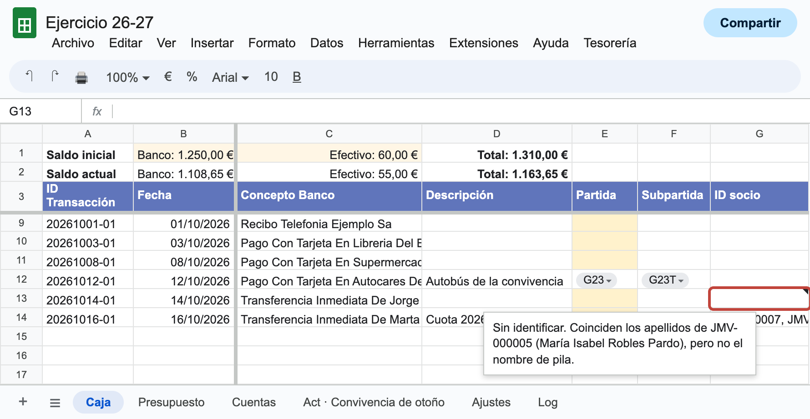
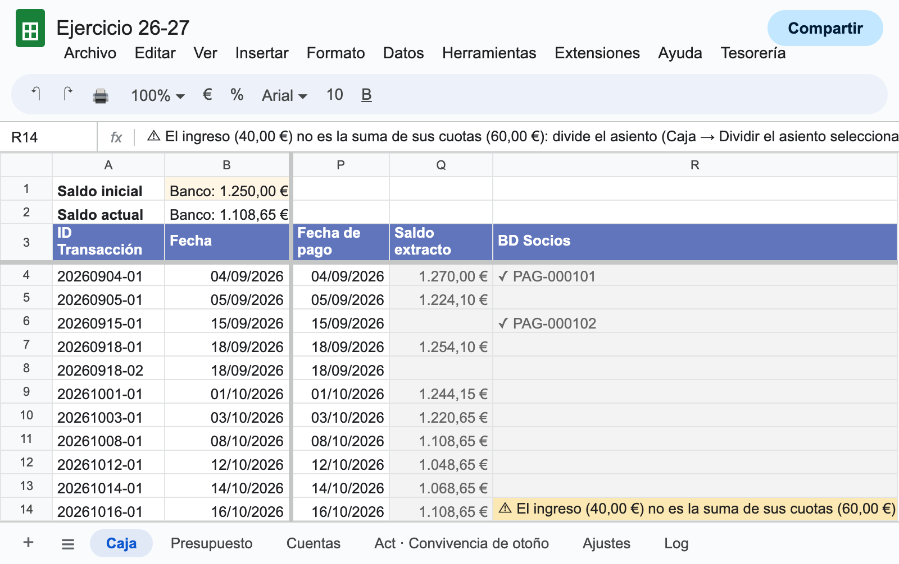

# Cuotas de socio

Si tu centro tiene la **base de datos de socios** (BD Socios), el libro se
conecta con ella. Cada cuota que se cobra se apunta en el libro **con el
número del socio** que paga (`JMV-000042`), y el libro la marca como pagada en
la base de socios. Así secretaría sabe quién ha pagado sin que nadie tenga que
pasar listas.

!!! info "Si tu centro todavía no tiene base de socios"

    Casi ninguno la tiene aún, y no pasa nada: el libro funciona igual. Lo
    único que cambia es que el libro no sabe de quién es cada cuota. Entonces:

    - las cuotas que llegan por el banco entran **sin partida**. Pónsela tú:
      la de cuotas del tramo que corresponda (`I11`, `I12` o `I13`), desde
      [Apuntar a mano en la hoja](escribir-en-la-hoja.md);
    - las cuotas en mano se apuntan con el nombre de quien paga y su tramo,
      desde [Efectivo y traspasos](efectivo.md#cuotas-cobradas-en-mano);
    - no hay nada que sincronizar: el panel no enseña ese botón.

    El resto de esta página es solo para los centros con base de socios.
    Cuando tu centro la tenga, la administración la conectará en la hoja
    **Ajustes**.

## Cuotas que llegan por el banco

Cuando una familia paga por transferencia o Bizum, el pago llega con el
extracto. Al [importarlo](importar-extracto.md), el libro intenta averiguar de
quién es cada ingreso:

1. por el **número de socio** escrito en el concepto;
2. por el **nombre del socio** en el concepto («Cuota Lucía Gómez»);
3. por **quién paga**: el propio socio, si es adulto, o su padre, madre o
   tutor, si el importe coincide con la cuota de sus hijos.

Si lo tiene claro, rellena la columna **ID socio**, pone la partida de cuotas
que le toca por edad y apunta el pago en la base de socios. **Si tiene la
mínima duda, no lo asigna**: deja la celda vacía con una nota que dice a quién
se parece.

!!! info "Por qué es tan prudente"

    Dos hermanos pueden llamarse Daniel y Daniela, o Mario y María. Antes que
    apuntar la cuota a quien no es, el libro prefiere preguntarte.

## Asignar a mano una cuota sin identificar

1. En la hoja **Caja**, busca el ingreso. Si tiene un triangulito negro en la
   celda **ID socio**, pasa el ratón por encima para leer la pista.

    

2. Si sabes de quién es, haz clic en la celda **ID socio** y escribe su número
   con el formato `JMV-000005` (lo encuentras en la base de socios). Pulsa
   **Intro**.
3. Menú **Tesorería → Sincronizar cuotas con BD Socios**. El libro pone la
   partida y apunta el pago en la base de socios.

!!! warning "Si la celda se pone roja"

    El ID está mal escrito. Tiene que ser `JMV-` seguido de seis cifras, con
    los ceros de delante: `JMV-000005`, no `JMV-5`.

### Un pago con la cuota de varios hermanos

Si una familia paga de una vez la cuota de dos hijos, escribe los dos números
separados por una coma: `JMV-000001, JMV-000002`. Esto solo vale si el importe
es **exactamente** la suma de sus cuotas.

Si no lo es (por ejemplo, pagan una cuota entera y parte de otra), hay que
**dividir el asiento** en dos:

1. Haz clic en cualquier celda de la fila del pago.
2. Menú **Tesorería → Caja → Dividir el asiento seleccionado…**
3. Escribe el importe de cada parte separados por punto y coma: `30; 10`.
   Tienen que sumar lo mismo que el pago.
4. Ahora son dos filas. Pon a cada una su **ID socio** y sincroniza.

## La columna BD Socios

Más a la derecha, la columna **BD Socios** dice qué ha hecho el libro con cada
cuota en la base de socios:

- **✓ PAG-000101**: la cuota está apuntada en la base de socios, con ese número
  de pago.
- **⚠ y fondo naranja**: algo impide apuntarla, y el texto dice qué. En el
  ejemplo, un ingreso de 40 € lleva dos socios cuyas cuotas suman 60 €: hay que
  dividir el asiento.

## Cuotas cobradas en mano

Se apuntan en **efectivo**, una por socio, desde **Tesorería → Ingreso o
gasto en efectivo… → Cuotas cobradas en mano**. Se explica paso a paso en
[Efectivo y traspasos](efectivo.md#cuotas-cobradas-en-mano).

## Sincronizar

La base de socios se pone al día sola al importar un extracto y al apuntar
cuotas en efectivo. Si cambias algo a mano en la hoja (un ID de socio, por
ejemplo), usa **Tesorería → Sincronizar cuotas con BD Socios**. Si te
equivocaste de socio y lo corriges, la sincronización también **deshace** el
pago que había apuntado al socio equivocado.

??? info "Sincronizar sola cada hora"

    En **Tesorería → Diagnóstico → Instalar sincronización automática**, el
    libro lleva a la base de socios lo que cambies en Caja, cada hora, sin que
    tengas que acordarte. Instálala solo en el libro del ejercicio en curso.

 
