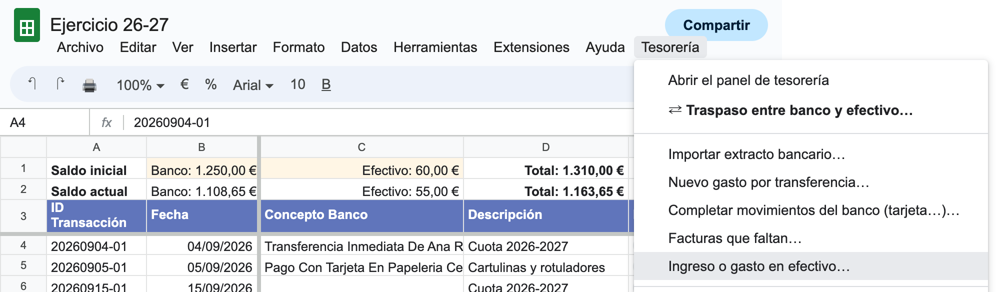
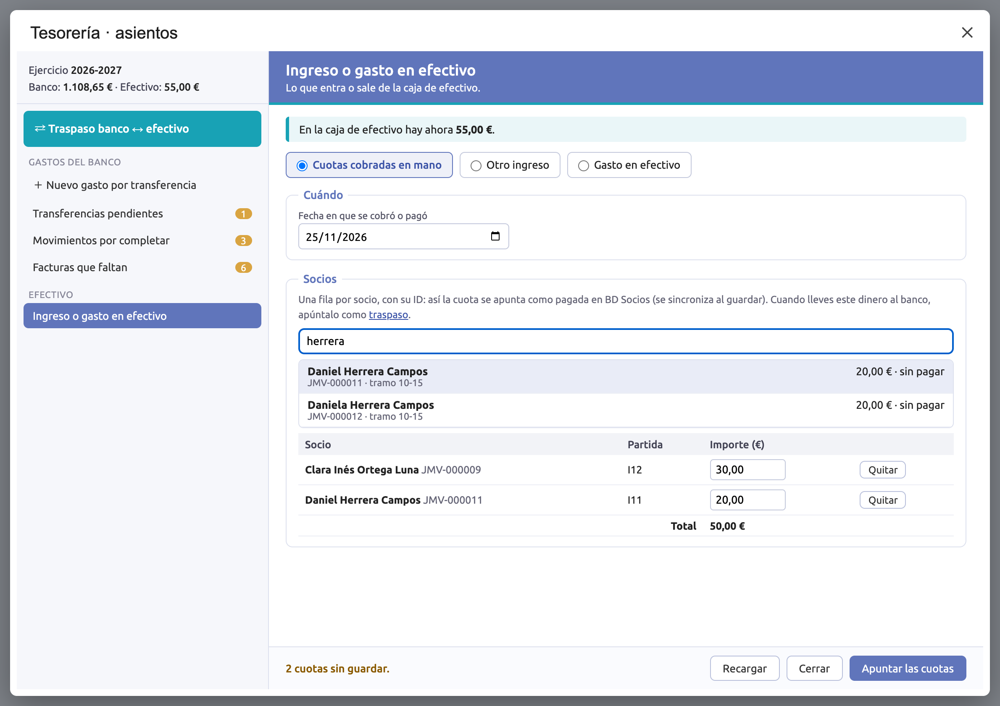
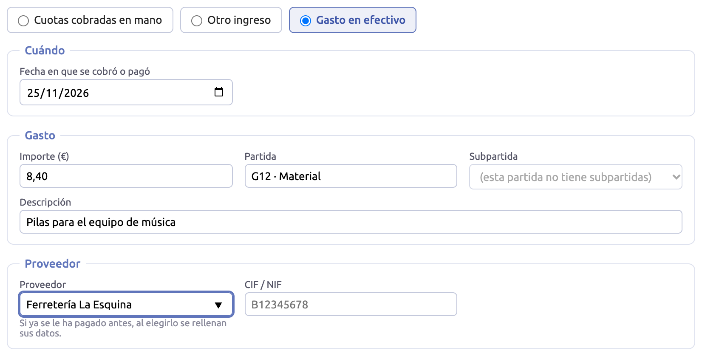
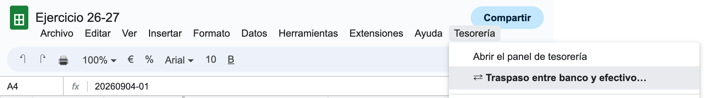
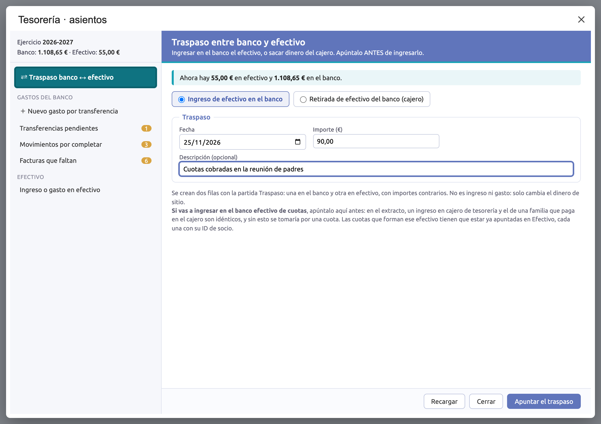

# Efectivo y traspasos

El centro tiene dinero en dos sitios: la **cuenta del banco** y el **efectivo**
(la caja con billetes y monedas). El libro lleva el saldo de los dos por
separado, así que cada vez que el efectivo cambia hay que apuntarlo.

Hay tres casos:

| Qué ha pasado | Qué es | Cómo se apunta |
|---|---|---|
| Has cobrado cuotas en mano, o has pagado algo en efectivo | Un **ingreso o gasto en efectivo** | [Ingreso o gasto en efectivo](#ingreso-o-gasto-en-efectivo) |
| Vas a **ingresar en el banco** el efectivo | Un **traspaso** | [Traspaso](#traspaso-entre-banco-y-efectivo) |
| Has **sacado dinero del cajero** | Un **traspaso** | [Traspaso](#traspaso-entre-banco-y-efectivo) |

## Ingreso o gasto en efectivo

Abre **Tesorería → Ingreso o gasto en efectivo…**

Arriba se ve cuánto efectivo debería haber ahora en la caja. Si al contar no
coincide, falta algo por apuntar.

### Cuotas cobradas en mano

Es lo más habitual: en la reunión de padres o el primer día, varias familias
pagan la cuota en efectivo.

1. Elige **Cuotas cobradas en mano** y pon la **fecha** en que se cobraron.
2. En el buscador, escribe el nombre, los apellidos o el número de socio.
   La primera vez tarda unos segundos: está leyendo la base de datos de socios.
3. Pulsa sobre el socio para añadirlo. A la derecha de cada uno ves su cuota
   y si ya figura como pagada.
4. Repite con cada socio que haya pagado. El importe de cada uno se rellena con
   su cuota; cámbialo si ha pagado otra cantidad.

    

5. Comprueba que el **total** coincide con el dinero que tienes y pulsa
   **Apuntar las cuotas**.

Se apunta una fila por socio y, en ese mismo momento, sus cuotas quedan como
pagadas en la base de datos de socios.

!!! info "Si tu centro no tiene base de socios"

    En vez del buscador de socios verás tres casillas: **quién paga**, su
    **tramo** y el **importe**. Rellénalas y pulsa **Añadir a la lista** por
    cada persona, y al final **Apuntar las cuotas**. Cada cuota queda en su
    partida de cuotas, con el nombre en la columna *Titular*. El nombre nunca
    sale en los informes.

!!! warning "Si un socio sale como «ya en Caja» o «pagada»"

    Quiere decir que ya hay un pago suyo apuntado. Antes de añadirlo,
    comprueba que no lo estás apuntando dos veces.

### Otro ingreso en efectivo

Para lo que no es una cuota (la venta de una rifa, una donación en mano…):
elige **Otro ingreso**, pon el importe, la **partida** (búscala por el nombre),
la subpartida si hay, y una descripción.

### Gasto en efectivo

Es raro, pero pasa: pilas, un recambio, el pan de la merienda. Elige **Gasto
en efectivo** y rellena el importe, la partida, la descripción y, si lo hay, el
proveedor y el ticket.

## Traspaso entre banco y efectivo

Cuando llevas el efectivo al banco, o sacas dinero del cajero, el dinero del
centro no aumenta ni disminuye: solo cambia de sitio. Eso es un **traspaso**.

!!! danger "Apunta el traspaso ANTES de ingresar el efectivo"

    En el extracto del banco, un ingreso en el cajero hecho por tesorería es
    **idéntico** al de una familia que paga su cuota en el cajero. Si el
    traspaso no está apuntado cuando importes el extracto, el libro tomará tu
    ingreso por la cuota de alguien.

    Las retiradas de cajero, en cambio, el libro las reconoce solas.

1. Menú **Tesorería → ⇄ Traspaso entre banco y efectivo…** Es la primera
   opción del menú.

    

2. Elige **Ingreso de efectivo en el banco** o **Retirada de efectivo del
   banco (cajero)**.
3. Pon la **fecha** y el **importe**. La descripción es opcional («Cuotas
   cobradas en la reunión de padres»).

    

4. Pulsa **Apuntar el traspaso**.

Se crean dos filas con la partida **Traspaso**: una en el banco (+90 €) y otra
en efectivo (−90 €). Cuando importes el extracto, la del banco se completará
con los datos del banco en vez de duplicarse.

!!! info "Primero las cuotas, luego el traspaso"

    Si el efectivo que vas a ingresar son cuotas, apúntalas antes como
    [cuotas cobradas en mano](#cuotas-cobradas-en-mano). Así cada familia
    queda registrada con su pago, y el traspaso solo mueve el total al banco.

??? info "Me olvidé del traspaso y ya importé el extracto"

    Busca en Caja la fila del ingreso en cajero, haz clic en ella y ve a
    **Tesorería → Caja → Convertir el asiento seleccionado en traspaso**. El
    libro le quita el socio que hubiera puesto y crea la fila de efectivo.

    Al revés: si el libro tomó por traspaso algo que era la cuota de una
    familia, **Tesorería → Caja → El asiento seleccionado no es un traspaso**
    lo deshace y busca al socio.

 
