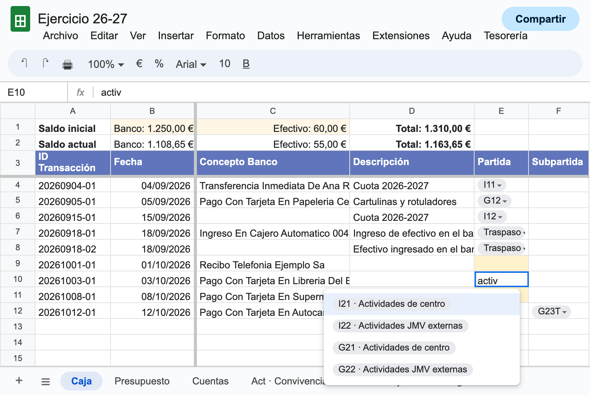

# Apuntar a mano en la hoja

Casi todo se apunta desde las ventanas del menú **Tesorería**, que comprueban
los datos por ti. Pero a veces es más rápido escribir directamente en la hoja
**Caja**: poner la partida a un ingreso, corregir una descripción, añadir un
proveedor… Esta guía explica cómo hacerlo sin estropear nada.

### Elegir una partida en la hoja

Las columnas **Partida** y **Subpartida** tienen una lista desplegable.

1. Haz clic en la celda de la partida.
2. Escribe **el código o parte del nombre**: «activ», «conviv», «material»…
   La lista se filtra mientras escribes.

    

3. Elige la partida con el ratón, o con las flechas y **Intro**.

En la celda queda **solo el código** (`G21`): el nombre sirve para buscar,
pero lo que se guarda es el código.

!!! info "Si la partida que buscas no aparece"

    Las partidas salen de la hoja **Presupuesto**. Si falta una, añádela allí
    (ver [Actividades y presupuesto](actividades.md)) y ya aparecerá en la
    lista.

La subpartida se elige igual. Tiene que ser **de la misma partida**: `G23T` va
con `G23`. Si no lo es, la celda se pone roja.

### Apuntar un asiento nuevo a mano

Si prefieres no usar las ventanas, también puedes escribir un asiento en la
primera fila vacía de Caja:

1. **Fecha**: escríbela como `15/10/2026`. Al pulsar Intro, el libro pone solo
   el **ID de transacción** y copia la fecha en **Fecha de pago**.
2. **Descripción**, **Partida** y, si es un gasto, **Proveedor** y **CIF**.
3. **Cantidad**: positiva si entra dinero, **negativa** si sale (`-12,50`).
4. **Método de pago**: elígelo de la lista. **Efectivo** cuenta en el saldo de
   efectivo; todo lo demás, en el del banco.

!!! warning "Lo que viene del banco, no se apunta a mano"

    Los pagos con tarjeta, los recibos y las cuotas que pagan las familias
    llegan solos con el extracto. Si los apuntas también a mano, el libro
    intentará juntarlos al importar, pero es fácil acabar con duplicados.
    Apunta a mano solo lo que el banco no va a traer: el efectivo, o una
    transferencia que vas a hacer (y para eso, mejor la
    [ventana de transferencias](pagar-transferencia.md)).

### Otras herramientas del menú Caja

En **Tesorería → Caja** hay herramientas que actúan sobre **la fila que tengas
seleccionada** (haz clic antes en cualquier celda de esa fila):

| Opción | Para qué |
|---|---|
| Dividir el asiento seleccionado… | Partir un movimiento en varios (dos cuotas de tramos distintos, una compra que es en parte material y en parte transporte). |
| Convertir el asiento seleccionado en traspaso | Un ingreso en cajero que era efectivo del centro, no la cuota de una familia. |
| El asiento seleccionado no es un traspaso | Lo contrario. |
| Adjuntar factura al asiento seleccionado… | Subir la factura de esa fila. |
| Ordenar por fecha de pago | Volver a ordenar Caja si una fecha sale en naranja. |
| Asignar los ID de transacción que falten | Por si alguna fila se ha quedado sin ID. |

 
