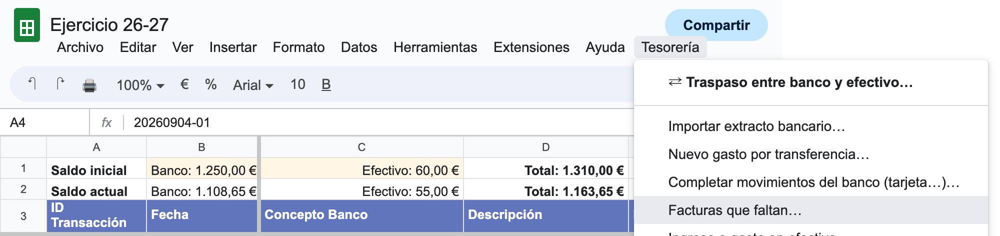
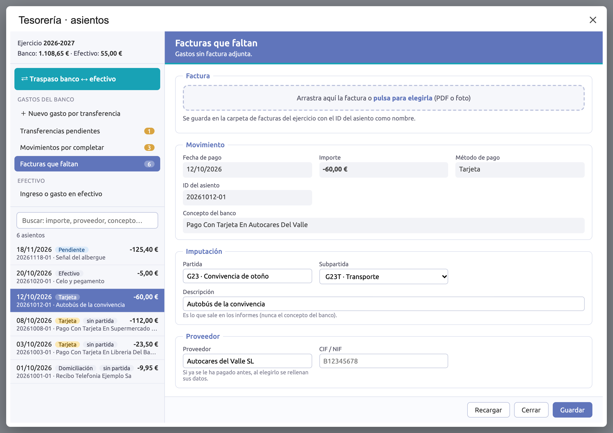
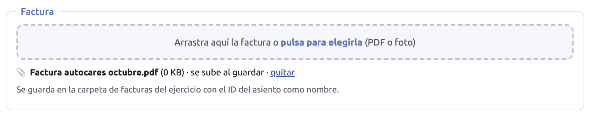

# Facturas

Todo gasto necesita su **factura** o, si es una compra pequeña, su **ticket**.
Es lo que demuestra en qué se gastó el dinero del centro, y lo primero que
pide cualquier revisión de cuentas.

El libro guarda cada factura en la carpeta **Facturas** de Tesorería, dentro
de una subcarpeta por ejercicio, y le pone de nombre **el ID de su asiento**
(`20261012-01.pdf`). Así, desde el asiento se llega a la factura, y desde la
factura al asiento.

!!! info "Pide factura a nombre del centro"

    Siempre que se pueda, pide **factura** (no solo ticket) a nombre de la
    asociación, con su CIF. Si solo hay ticket, haz una foto en cuanto lo
    tengas: los tickets de papel térmico se borran en pocos meses.

### Subir las facturas que faltan

1. Menú **Tesorería → Facturas que faltan…**

    

2. A la izquierda salen **todos los gastos sin factura**: los de tarjeta, los
   de efectivo, las transferencias pendientes… Elige uno.

    

3. Arrastra la factura al recuadro de arriba, o pulsa en él para buscarla en
   tu ordenador. Vale un **PDF** o una **foto** (también la del móvil).

    

4. Pulsa **Guardar**. La factura se sube, el asiento la enlaza y la ventana
   pasa al siguiente gasto sin factura.

Debajo de la factura puedes, de paso, completar o corregir la partida, la
descripción o el proveedor.

### Otras formas de subir una factura

- **Al apuntar el gasto**: las ventanas de [transferencia](pagar-transferencia.md),
  [completar movimientos](completar-movimientos.md) y [efectivo](efectivo.md)
  tienen su propio recuadro para la factura.
- **Desde la hoja**: haz clic en cualquier celda de la fila del asiento en
  Caja y ve a **Tesorería → Caja → Adjuntar factura al asiento seleccionado…**
- **Directamente en Drive**: si subes un archivo a la carpeta de facturas del
  ejercicio con el ID del asiento como nombre (`20261012-01.pdf`), luego
  **Tesorería → Caja → Vincular facturas subidas a la carpeta** lo enlaza.

### Dónde ver la factura de un asiento

En la hoja Caja, la columna **Factura** tiene el enlace: haz clic en él para
abrirla. Si la celda está en **amarillo**, a ese gasto le falta la factura.

!!! success "Gastos que no necesitan factura"

    Los traspasos entre banco y efectivo y las comisiones del banco no piden
    factura, y no salen en esta lista.

 
