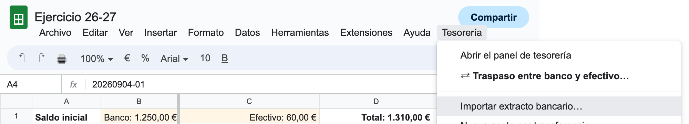
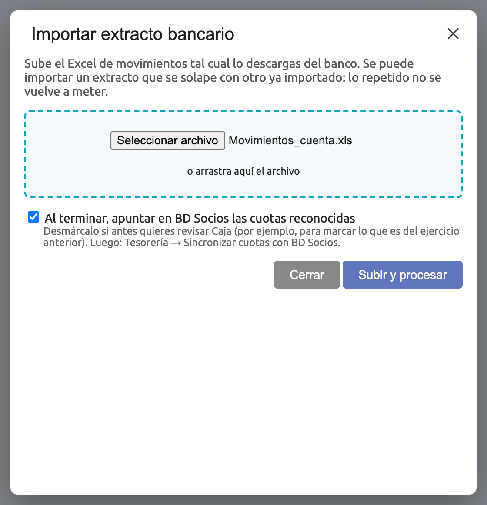
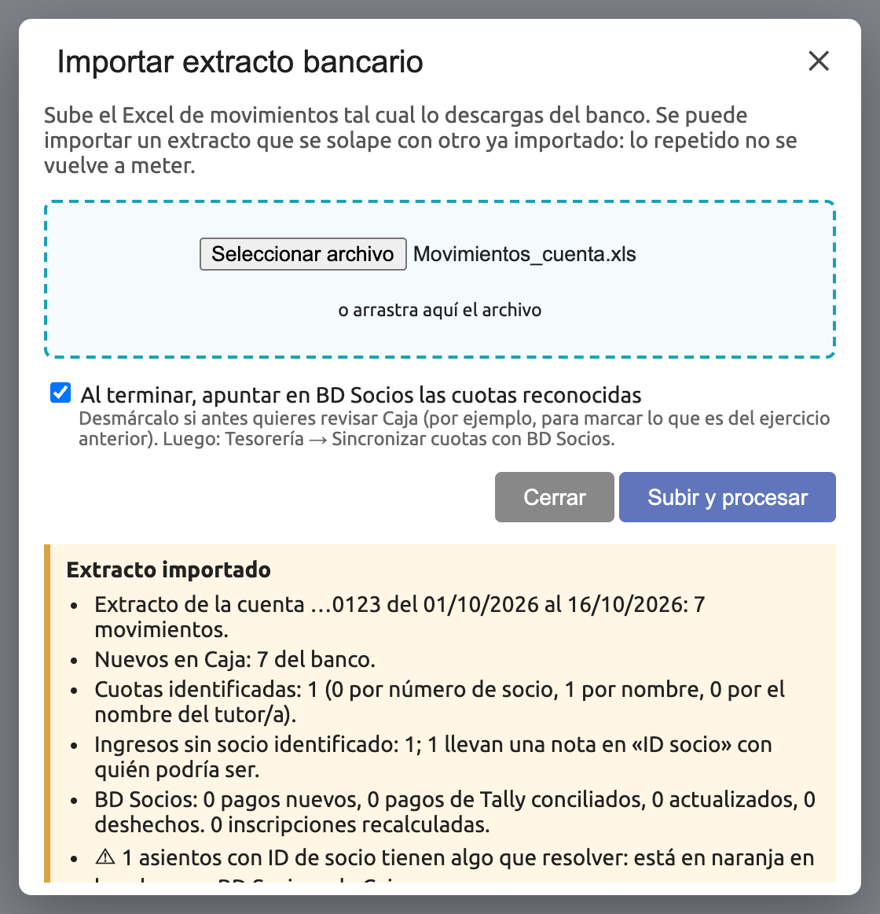
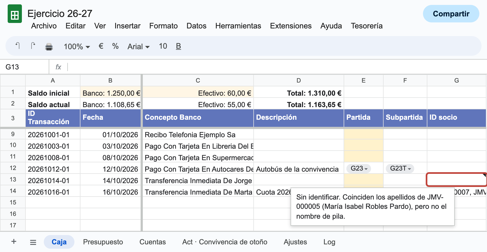

# Importar el extracto del banco

El **extracto** es la lista de movimientos de la cuenta que da el banco.
Importarlo mete en el libro, de una vez, todo lo que ha pasado por el banco:
las cuotas que han pagado las familias, los pagos con tarjeta, los recibos,
las comisiones… Así no hay que copiarlos a mano.

Hazlo **cada dos o tres semanas**, y siempre antes de sacar un informe.

!!! success "No se duplica nada"

    Puedes importar un extracto que se solape con otro que ya importaste (por
    ejemplo, «todo el mes» dos veces). El libro reconoce cada movimiento y no
    mete dos veces el mismo. Tampoco duplica lo que ya habías apuntado tú
    antes, como las [transferencias](pagar-transferencia.md) o los
    [traspasos](efectivo.md): los completa con los datos del banco.

### 1. Descarga el extracto de la web del banco

1. Entra en la **banca online** del banco con el usuario del centro.
2. Abre la cuenta del centro y busca la lista de **movimientos**.
3. Elige las fechas: desde el último extracto que importaste (o un poco antes)
   hasta hoy. Si no te acuerdas, la hoja **Ajustes** lo dice en *Último
   extracto importado*.
4. Pulsa **Descargar** o **Exportar** y elige el formato **Excel**. Guárdalo
   en tu ordenador **sin abrirlo ni cambiarle nada**.

!!! warning "El extracto tiene datos personales"

    El concepto de cada transferencia lleva nombres de familias y de menores.
    En cuanto lo hayas importado, **bórralo de tu carpeta de Descargas**: el
    libro ya guarda una copia en la carpeta de extractos del centro, que está
    protegida. No lo mandes por correo ni por WhatsApp.

### 2. Súbelo al libro

1. En el libro, menú **Tesorería → Importar extracto bancario…**

    

2. En la ventana, pulsa **Seleccionar archivo** y elige el Excel que has
   descargado (o arrástralo dentro del recuadro).

    

3. Si tu centro tiene base de socios, verás la casilla **Al terminar, apuntar
   en BD Socios las cuotas reconocidas**. Déjala marcada, salvo que sepas que
   el extracto trae algo raro (por ejemplo, pagos del curso pasado: ver
   [Cambio de ejercicio](cambio-de-ejercicio.md)).
4. Pulsa **Subir y procesar** y espera. Puede tardar hasta un minuto.

### 3. Lee el resumen

Al terminar, la ventana dice qué ha hecho:

- **Nuevos en Caja**: cuántos movimientos se han añadido.
- **Cuotas identificadas** (solo con base de socios): ingresos en los que el
  libro ha reconocido qué socio paga. Esas cuotas se apuntan solas como
  pagadas en la base de datos de socios.
- **Ingresos sin socio identificado**: los que no ha sabido de quién son. Ver
  [Cuotas de socio](cuotas.md).
- **✓ El saldo calculado coincide con el del banco**: todo cuadra. Si en vez de
  esto sale un aviso ⚠, mira [Si algo no cuadra](si-algo-no-cuadra.md).

Las líneas con ⚠ son cosas que el libro no ha querido decidir solo. Cada una
dice qué hacer.

### 4. Mira las notas

Cuando el libro duda, deja una **nota** en la celda: se reconoce por un
**triangulito negro** en la esquina. Pasa el ratón por encima para leerla.

En este ejemplo, el libro ha visto los apellidos de una socia en el concepto,
pero no su nombre, y no se ha atrevido a asignárselo. Cómo resolverlo está en
[Cuotas de socio](cuotas.md).

### 5. Y ahora…

Después de importar, quedan dos tareas:

1. [Completar los pagos con tarjeta](completar-movimientos.md) y demás gastos
   que han llegado sin partida.
2. [Subir las facturas](facturas.md) que falten.

 
