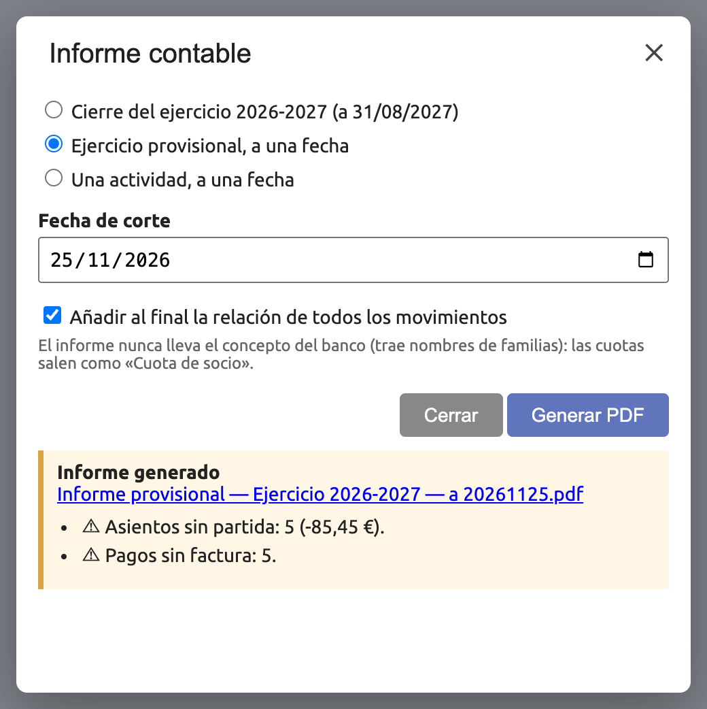
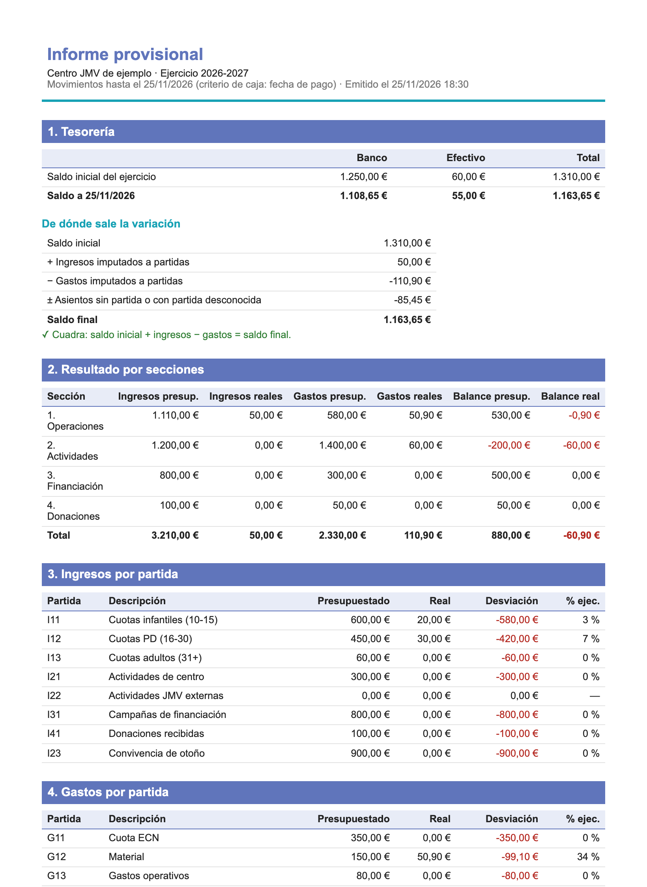

# Informes

El libro prepara solo los **informes contables en PDF** que se presentan al
equipo, a la asamblea o al Secretariado. Se guardan en la carpeta **Memorias**
de Tesorería.

Hay tres tipos:

| Informe | Para qué |
|---|---|
| **Cierre del ejercicio** | Las cuentas del curso completo, a 31 de agosto. Es la memoria económica anual. |
| **Provisional, a una fecha** | Cómo van las cuentas hasta un día concreto. Para una reunión del equipo, por ejemplo. |
| **De una actividad, a una fecha** | Las cuentas de una sola actividad (una convivencia, la lotería). |

### Antes de sacar un informe

Para que el informe sea fiable:

1. [Importa el extracto](importar-extracto.md) hasta la fecha del informe.
2. [Completa los movimientos](completar-movimientos.md) que no tengan partida.
3. Sube las [facturas que falten](facturas.md).

Si no lo haces, el informe sale igual, pero con avisos.

### Generar el informe

1. Menú **Tesorería → Generar informe contable…**
2. Elige el tipo de informe y la **fecha de corte** (hasta qué día cuenta).
3. Si quieres, marca **Añadir al final la relación de todos los movimientos**.
4. Pulsa **Generar PDF**. Cuando termine, pulsa el enlace para abrirlo.

    

Las líneas con ⚠ son cosas que conviene arreglar antes de dar el informe por
bueno: asientos sin partida, pagos sin factura, saldos que no cuadran con el
banco…

### Qué trae el informe

1. **Tesorería**: cuánto había al empezar el ejercicio y cuánto hay en la fecha
   de corte, en el banco y en efectivo, y de dónde sale la diferencia. Si todo
   está bien apuntado, termina con **✓ Cuadra**.
2. **Resultado por secciones**: presupuestado y real de cada sección.
3. **Ingresos y gastos por partida**, con la desviación y el porcentaje
   ejecutado.
4. **Actividades**, una línea por cada hoja de actividad.
5. **Avisos** y, si lo pediste, la **relación de movimientos**.

!!! info "El informe cuenta por fecha de pago"

    Un informe a una fecha solo incluye lo que **se ha pagado o cobrado** hasta
    ese día. Por eso una transferencia
    [pendiente](pagar-transferencia.md#6-mientras-tanto-pendiente) no sale
    todavía, aunque sí cuente ya en la hoja Cuentas y en la de su actividad.

!!! success "Sin datos personales"

    El informe **nunca** incluye el concepto del banco, que lleva nombres de
    familias: las cuotas salen como «Cuota de socio». Se puede compartir con el
    equipo sin problema.

 
