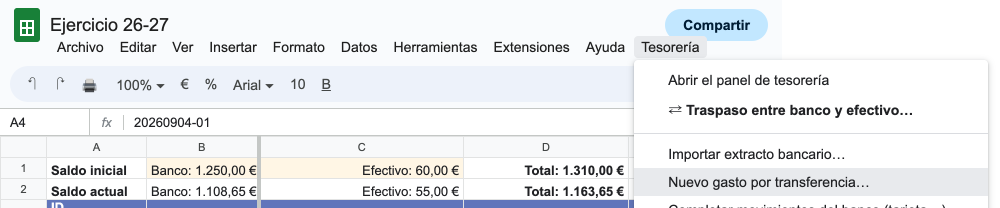
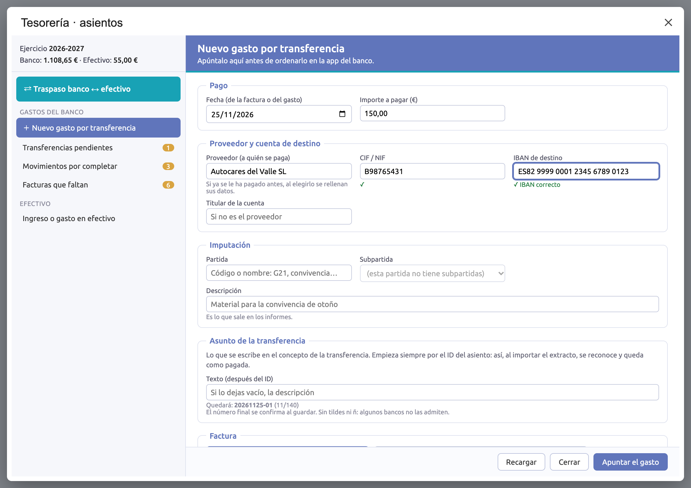
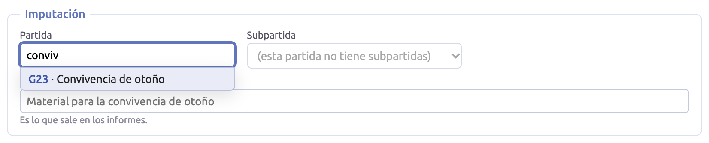
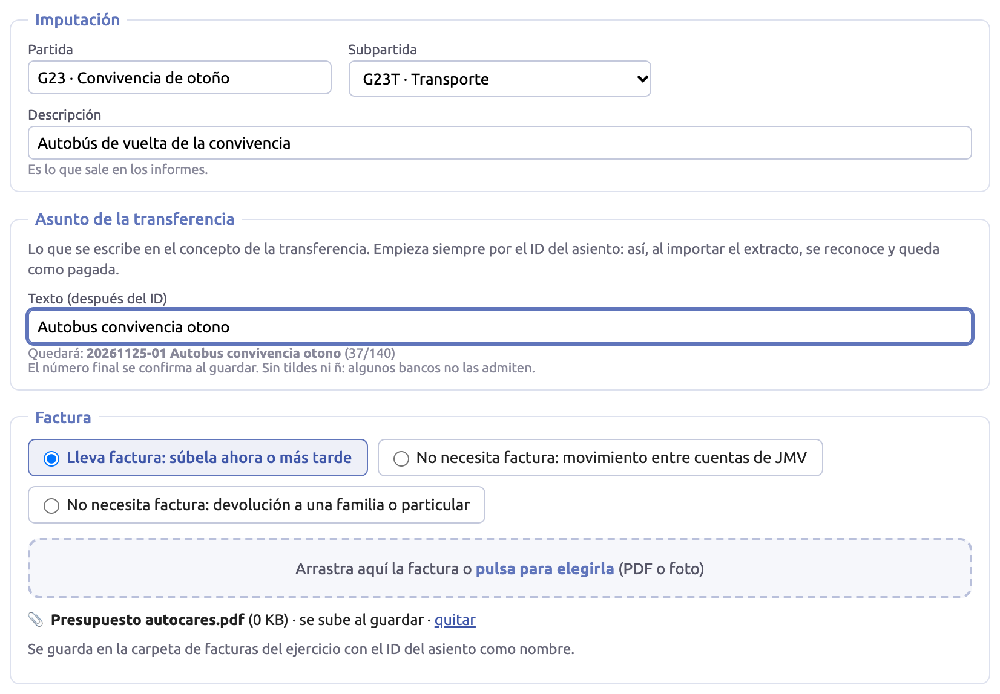
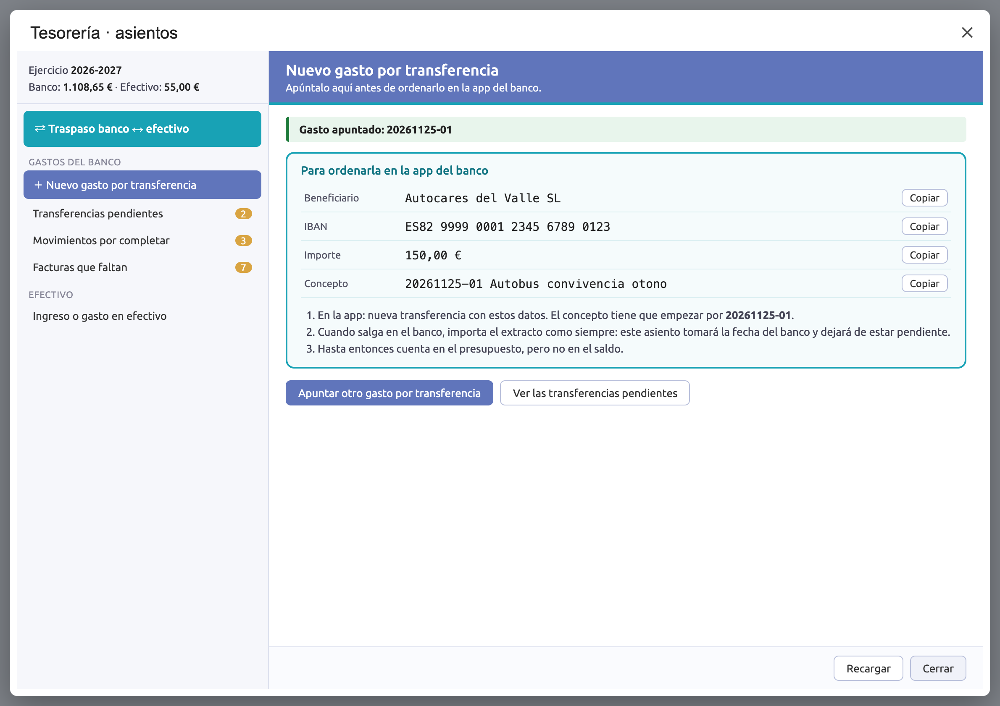
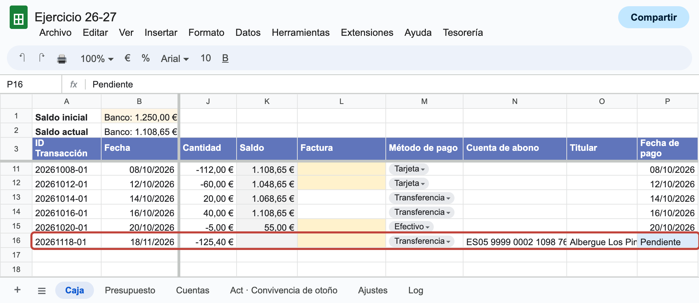
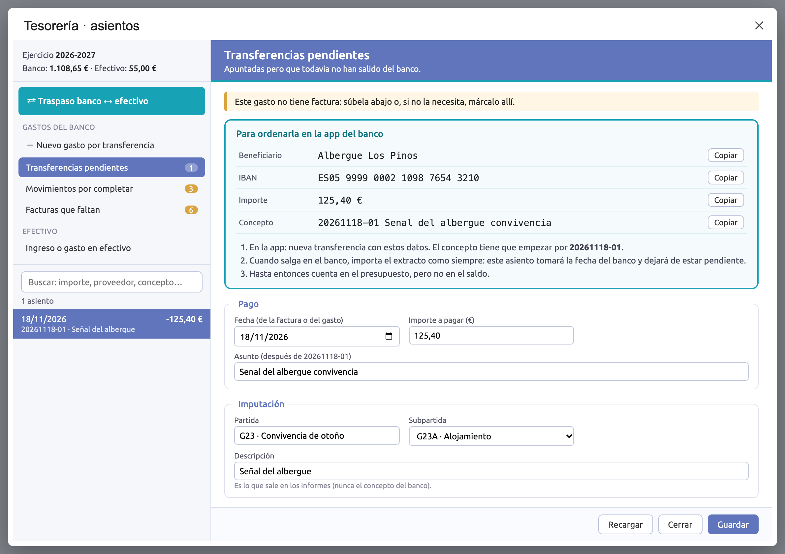

# Pagar por transferencia

Cuando el centro paga una factura por transferencia (el autobús de la
convivencia, el albergue, una imprenta…), el orden es siempre el mismo:

1. **Apuntas el gasto en el libro**, con todos sus datos y, si ya la tienes,
   la factura.
2. El libro te da **lo que hay que escribir en la app del banco**, incluido el
   concepto, que empieza por el ID del asiento.
3. **Haces la transferencia** en la app del banco.
4. Cuando **importas el extracto**, el libro reconoce esa transferencia y la da
   por pagada. No tienes que hacer nada más.

!!! info "¿Por qué apuntarlo antes de pagar?"

    Porque así los datos del proveedor (CIF, cuenta, factura) se apuntan
    cuando los tienes delante, y el pago queda enlazado a su asiento por el
    ID. Cuando llegue el extracto, solo dirá «Transferencia a Autocares del
    Valle»; sin el ID, habría que adivinar de qué era.

### 1. Abre la ventana

Menú **Tesorería → Nuevo gasto por transferencia…**

Se abre la ventana de asientos, en la sección **Nuevo gasto por
transferencia**. A la izquierda tienes el resto de secciones; puedes moverte
entre ellas sin cerrar la ventana.

### 2. Rellena los datos del pago

1. **Fecha**: la de la factura o del gasto. Si no tienes factura todavía, deja
   la de hoy.
2. **Importe a pagar**: en euros, sin signo (`150,00`). El libro ya sabe que es
   un gasto.
3. **Proveedor**: a quién se paga. Si ya se le ha pagado antes, aparece en la
   lista al escribir, y al elegirlo se rellenan solos su CIF y su cuenta.
4. **CIF / NIF** del proveedor. Sale en su factura. El libro comprueba la letra
   o el dígito de control y pone una ✓ si es correcto.
5. **IBAN de destino**: la cuenta a la que hay que pagar. Puedes pegarla con o
   sin espacios. Si falta un número o hay una errata, sale en rojo **antes** de
   que llegues a pagar.
6. **Titular de la cuenta**: solo si no es el propio proveedor.

### 3. Di para qué es el gasto

En **Partida**, escribe el código o parte del nombre y elige de la lista:

Después, si la partida tiene subpartidas, elige la que corresponda (en una
convivencia: alojamiento, manutención, transporte o material), y escribe una
**descripción** corta de qué es el gasto. La descripción es lo que sale en los
informes, así que mejor «Autobús de vuelta de la convivencia» que «Pago».

### 4. El asunto y la factura

- **Asunto**: el texto que irá en el concepto de la transferencia, **después
  del ID**. Si lo dejas vacío, se usa la descripción. Debajo ves cómo quedará.
  El libro quita las tildes y la ñ, que algunos bancos no admiten.
- **Factura**: si ya la tienes, arrástrala al recuadro o pulsa para elegirla
  (PDF o foto). Si aún no la tienes, no pasa nada: podrás subirla después desde
  [Facturas](facturas.md). Si es un **movimiento entre cuentas de JMV** o una
  **devolución** a una familia, elige la opción **No necesita factura** que
  corresponda ([Gastos que no llevan factura](facturas.md#gastos-que-no-llevan-factura)).

Pulsa **Apuntar el gasto**.

### 5. Copia los datos en la app del banco

La ventana te enseña lo que tienes que poner en la transferencia, con un botón
**Copiar** al lado de cada dato:

1. Abre la app o la web del banco y empieza una **transferencia nueva**.
2. Pulsa **Copiar** en cada dato y pégalo en su sitio: beneficiario, IBAN,
   importe y concepto.
3. Comprueba que el **concepto empieza por el ID** (`20261125-01` en el
   ejemplo) y confirma la transferencia.

!!! danger "No cambies el principio del concepto"

    El ID del principio es lo que permite al libro reconocer el pago cuando
    llegue en el extracto. Puedes acortar el resto del texto si el banco no te
    deja tanto, pero **el ID tiene que estar**.

### 6. Mientras tanto: pendiente

Hasta que la transferencia aparezca en un extracto, el asiento está
**pendiente**: en la hoja Caja, su *Fecha de pago* dice **Pendiente** y sale en
azul.

Un gasto pendiente:

- **sí** cuenta en el presupuesto de su partida y de su actividad (ese dinero
  ya está comprometido);
- **no** cuenta en el saldo del banco (todavía no ha salido), ni en los
  informes.

Cuando importes el extracto que trae la transferencia, el libro la reconoce
por el ID y le pone la fecha del banco. El resumen de la importación lo dice:
*Transferencias pendientes que ya han salido del banco*.

### Corregir o anular una transferencia pendiente

Las que aún no han salido están en la sección **Transferencias pendientes** de
la ventana. Elige una en la lista de la izquierda para ver otra vez sus datos
del banco, corregir algo (el importe, el IBAN, la partida…) o subir su factura.

Si al final **no se va a pagar**, pulsa **Anular esta transferencia**, abajo
del todo. El asiento se borra del libro.

!!! warning "Si ya la has hecho en el banco, no la anules"

    Anular solo borra el apunte del libro: no deshace nada en el banco. Si la
    transferencia ya está hecha, déjala pendiente y se completará sola al
    importar el extracto.

??? info "¿Y si el banco corta el concepto o cambio el importe?"

    Si el banco no conserva el ID, el libro intenta reconocer la transferencia
    por el importe y la fecha (hasta cuatro meses después de la fecha del
    asiento). Si hay dudas, la importa como un movimiento nuevo y deja una
    nota en su *Concepto Banco* diciendo con qué asiento puede ser el mismo.
    Si es así, pasa a la fila del banco lo que le falte (partida, proveedor,
    factura) y **borra la que apuntaste tú**, la pendiente. Nunca borres la
    del banco: el siguiente extracto la volvería a meter.

 
