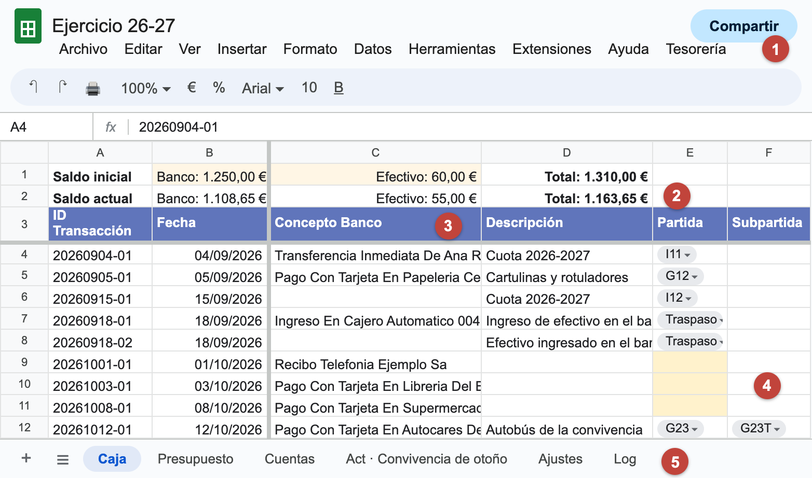
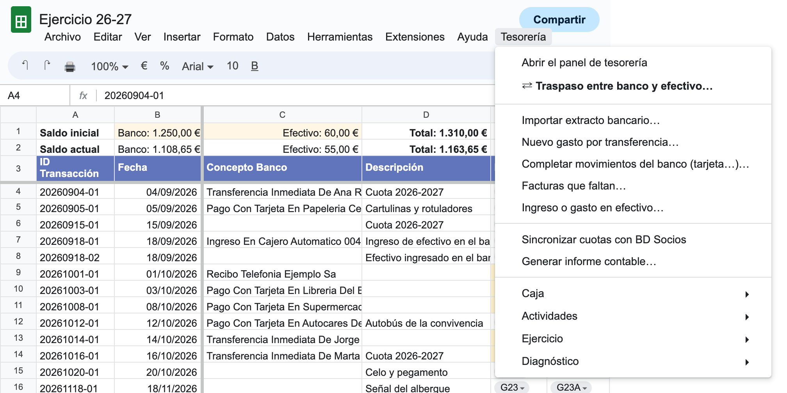
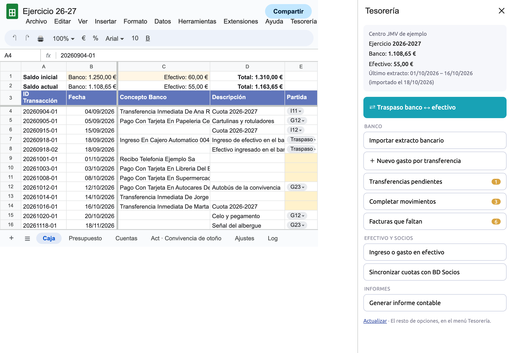
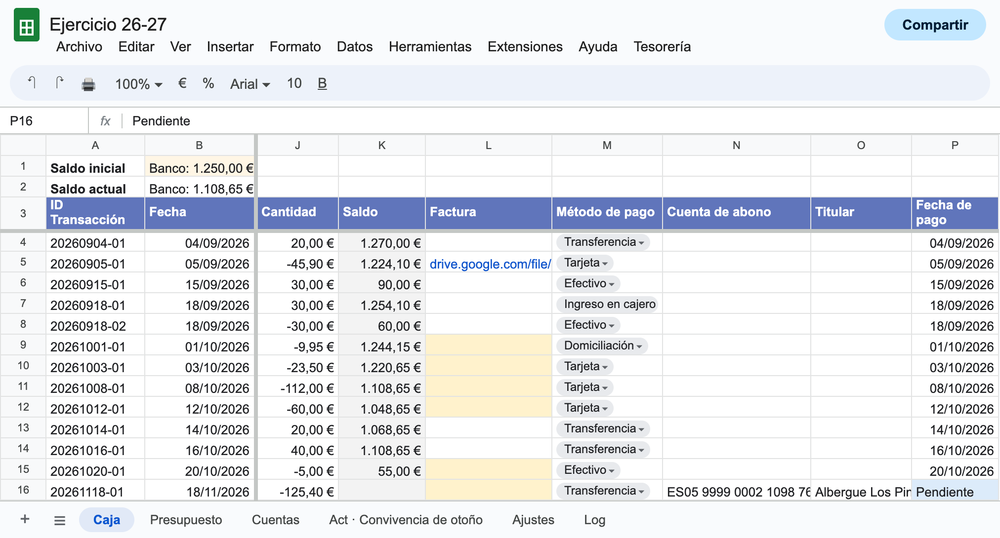

# Primeros pasos con el libro

Esta guía es para quien no ha usado nunca **Hojas de cálculo de Google** (la
versión de Google de Excel). En diez minutos sabrás moverte por el libro sin
miedo a romper nada.

### 1. Abre el libro

1. Entra en **Google Drive** con tu cuenta del centro (`@jmvesp.org`).
2. En el menú de la izquierda, pulsa **Unidades compartidas** y entra en la de
   tu centro. Si no sabes qué es una unidad compartida, lo tienes explicado en
   [Unidades compartidas](https://jmv-espana.github.io/documentacion-publica/Corporativo/Pol%C3%ADticas/unidades-compartidas/).
3. Entra en la carpeta **Tesorería** y abre el archivo del ejercicio en curso,
   por ejemplo **Ejercicio 26-27**.

!!! info "Un libro por curso"

    Cada ejercicio (de septiembre a agosto) tiene su propio archivo. Los de
    años anteriores siguen en la misma carpeta: no los borres, son las cuentas
    cerradas de esos años.

### 2. Lo que ves en pantalla

1. **El menú Tesorería.** Está arriba, al final de la barra de menús (después
   de *Ayuda*). Desde él se hace casi todo. Al abrir el libro tarda unos
   segundos en aparecer.
2. **Los saldos.** La fila 1 dice con cuánto dinero empezó el ejercicio, en el
   banco y en efectivo; la fila 2, cuánto hay ahora. Se calculan solos.
3. **La cabecera.** Los nombres de las columnas (*Fecha*, *Concepto Banco*,
   *Partida*…). Se quedan fijos arriba aunque bajes por la hoja.
4. **Los asientos.** Cada fila es un movimiento de dinero, ordenados por fecha.
5. **Las pestañas.** Abajo del todo. El libro tiene varias hojas, y aquí se
   cambia de una a otra.

??? info "Celdas, filas y columnas"

    Una hoja de cálculo es una cuadrícula. Las **columnas** se nombran con
    letras (A, B, C…) y las **filas** con números (1, 2, 3…). Cada casilla es
    una **celda**, y se nombra por su columna y su fila: **E9** es la celda de
    la columna E y la fila 9.

    Para escribir en una celda, haz clic en ella, escribe y pulsa **Intro**.
    Si te equivocas, pulsa **Ctrl + Z** (en Mac, **⌘ + Z**) para deshacer.

### 3. Las pestañas del libro

| Pestaña | Para qué sirve |
|---|---|
| **Caja** | El libro de asientos: todos los movimientos. Es la que más vas a ver. |
| **Presupuesto** | Las partidas y lo que se espera ingresar y gastar en cada una. |
| **Cuentas** | Lo mismo que Presupuesto, pero con lo que se ha movido de verdad. Se rellena sola. |
| **Act · …** y **Fin · …** | Una por actividad (convivencia, campamento, lotería…), con su presupuesto y sus movimientos. |
| **Ajustes** | Datos del ejercicio (fechas, curso) y del centro (nombre, código, carpetas, cuenta del banco). Casi todo se rellena solo y normalmente no se toca. |
| **Log** | Un registro de lo que ha hecho el sistema. Sirve para buscar qué pasó. |

### 4. El menú y el panel de tesorería

La primera opción, **Abrir el panel de tesorería**, es la más cómoda. Abre a
la derecha de la hoja un panel con un botón para cada tarea, que se queda
abierto mientras trabajas:

Arriba del todo está el **traspaso entre banco y efectivo**, destacado porque
es lo que hay que apuntar *antes* de ingresar o sacar efectivo. Debajo, lo que
se usa a menudo: importar el extracto, pagar por transferencia, completar los
pagos con tarjeta, las facturas y el efectivo. Los números en naranja dicen
cuántas cosas quedan pendientes en cada lista.

En el menú hay además unos submenús (*Caja*, *Actividades*, *Ejercicio*,
*Diagnóstico*) para tareas menos frecuentes.

!!! info "En estas guías"

    Cuando leas **Tesorería → Facturas que faltan…**, puedes usar el menú o
    el botón equivalente del panel: es lo mismo.

### 5. La primera vez: autorizar el programa

El libro lleva dentro un pequeño programa (el que hace funcionar el menú, las
ventanas y el panel). La primera vez que uses una opción del menú, Google te
pide permiso para que ese programa pueda trabajar con tu cuenta:

1. Sale «**Se necesita autorización**». Pulsa **Continuar** y elige la cuenta
   con la que trabajas en el libro (la del centro o tu @gmail).
2. Sale «**Google no ha verificado esta aplicación**». Es normal: el programa
   es de JMV España y no está publicado en ninguna tienda. Pulsa
   **Configuración avanzada** (abajo a la izquierda) y luego **Ir a … (no
   seguro)**.
3. Revisa la lista de permisos y pulsa **Permitir**.
4. Vuelve a elegir la opción del menú que querías.

!!! info "Una vez por libro"

    Se hace una vez por persona y por libro. Cada septiembre, con el libro del
    ejercicio nuevo, toca hacerlo otra vez. Si un día el programa necesita
    permisos nuevos, también lo volverá a pedir.

### 6. Los colores

El libro pinta las celdas para avisarte de lo que hay que mirar:

| Color | Qué quiere decir | Qué hacer |
|---|---|---|
| **Amarillo** | Falta algo: la partida o la factura. | [Completar los pagos](completar-movimientos.md) o [subir la factura](facturas.md). |
| **Azul** (en *Fecha de pago*) | Transferencia apuntada que aún no ha salido del banco. | Nada: al importar el extracto que la trae, deja de estar pendiente. |
| **Naranja** | Algo raro que conviene mirar. | Ver [Si algo no cuadra](si-algo-no-cuadra.md). |
| **Rojo** | Algo está mal: el saldo no coincide con el del banco, un ID de socio mal escrito… | Ver [Si algo no cuadra](si-algo-no-cuadra.md). |
| **Gris** | Columnas que calcula el libro. | No se escriben a mano. |

Fíjate en la columna **Saldo**: cada fila enseña el saldo **de su caja**. Las
filas del banco llevan el saldo del banco, y las de efectivo (como la 6 o la
8), el del efectivo.

### 7. Lo que nunca hay que hacer

!!! danger "Para no romper el libro"

    - **No insertes, borres ni muevas columnas** en la hoja Caja. Todas las
      cuentas dependen de que cada dato esté en su columna.
    - **No escribas en la columna Saldo**, ni para borrarla: es una fórmula
      que calcula todos los saldos a la vez.
    - **No borres asientos que vienen del banco** (los que tienen *Concepto
      Banco*): el siguiente extracto los volvería a meter. Si sobra uno, mira
      [Si algo no cuadra](si-algo-no-cuadra.md).

    Si algo de esto pasa por accidente, **Ctrl + Z** lo deshace. Y si ya es
    tarde, el menú **Archivo → Historial de versiones → Ver historial de
    versiones** permite volver a cómo estaba el libro antes.

Algunas zonas del libro están **protegidas**: si intentas escribir en ellas,
Google te avisa antes. Es normal; casi siempre basta con cancelar.

 
